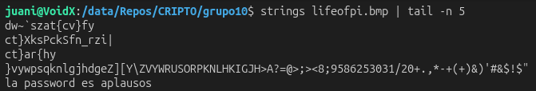

<div align="center">

<br>


<br><br>

<h1 style="color: #0b5394; border-bottom: none; margin-bottom: 4px;">72.44 - Criptografía y Seguridad</h1>

<h2 style="border-bottom: none; margin-top: 4px; color: #222222;">Trabajo Práctico de Implementación:<br>Esteganografía (<code>stegobmp</code>)</h2>

<br>

<h3>Grupo 10</h3>

| Legajo | Apellido | Nombre |
| :---: | :--- | :--- |
| 61105 | Causse | Juan Ignacio |
| 64679 | Lanari | Augusto Andrés |
| 64332 | Liu | Javier Emmanuel |
| 64292 | Rivas | Nicolás |

<br>

<table style="border: none; border-collapse: collapse;">
  <tr>
    <td style="border: none; padding: 4px 12px;"><strong>Fecha de entrega:</strong></td>
    <td style="border: none; padding: 4px 12px;">16 de Noviembre de 2026</td>
  </tr>
  <tr>
    <td style="border: none; padding: 4px 12px;"><strong>Repositorio:</strong></td>
    <td style="border: none; padding: 4px 12px;"><a href="https://github.com/jcausse-itba/CRIPTO">https://github.com/jcausse-itba/CRIPTO</a></td>
  </tr>
  <tr>
    <td style="border: none; padding: 4px 12px;"><strong>Branch:</strong></td>
    <td style="border: none; padding: 4px 12px;"><code>main</code></td>
  </tr>
  <tr>
    <td style="border: none; padding: 4px 12px;"><strong>Commit Hash:</strong></td>
    <td style="border: none; padding: 4px 12px;"><code>39cdd24ec5daaf2385633f67e07e633643abc1f6</code></td>
  </tr>
</table>

</div>

<div style="page-break-after: always;"></div>

## Índice

1. [Discusión sobre la Publicación Científica (Majeed & Sulaiman)](#1-discusión-sobre-la-publicación-científica-majeed--sulaiman) *(Apartado I)*
   - [1.1. Organización Formal del Documento](#11-organización-formal-del-documento) *(I.a)*
   - [1.2. Descripción del Algoritmo](#12-descripción-del-algoritmo) *(I.b)*
   - [1.3. Claridad de Notación, Errores y Contradicciones](#13-claridad-de-notación-errores-y-contradicciones) *(I.c)*
2. [Análisis Comparativo de Algoritmos (`LSB1`, `LSB4` y `LSBI`)](#2-análisis-comparativo-de-algoritmos-lsb1-lsb4-y-lsbi) *(Apartado II)*
   - [2.1. Ocultamiento de Prueba y Comparación de Resultados](#21-ocultamiento-de-prueba-y-comparación-de-resultados)
   - [2.2. Cuadro Comparativo de Ventajas y Desventajas](#22-cuadro-comparativo-de-ventajas-y-desventajas)
3. [Estegoanálisis de los Archivos Provistos](#3-estegoanálisis-de-los-archivos-provistos) *(Sección 6 y Apartados III–VI)*
   - [3.1. Metodología y Procedimiento de Descubrimiento](#31-metodología-y-procedimiento-de-descubrimiento) *(III)*
   - [3.2. Resultados por Archivo Portador](#32-resultados-por-archivo-portador) *(III)*
   - [3.3. Análisis de Mensajes Anidados](#33-análisis-de-mensajes-anidados) *(IV)*
   - [3.4. Análisis de la Escena de Video / Película](#34-análisis-de-la-escena-de-video--película) *(V)*
   - [3.5. Algoritmo No Estándar Encontrado](#35-algoritmo-no-estándar-encontrado) *(VI)*
4. [Discusión Técnica y Mejoras del Algoritmo](#4-discusión-técnica-y-mejoras-del-algoritmo) *(Apartados VII–X)*
   - [4.1. Fundamentación de la Mejora de LSBI frente a LSB Convencional](#41-fundamentación-de-la-mejora-de-lsbi-frente-a-lsb-convencional) *(VII)*
   - [4.2. Alternativas para el Registro de Patrones Invertidos](#42-alternativas-para-el-registro-de-patrones-invertidos) *(VIII)*
   - [4.3. Dificultades Encontradas durante la Implementación](#43-dificultades-encontradas-durante-la-implementación) *(IX)*
   - [4.4. Propuestas de Mejoras y Extensiones Futuras](#44-propuestas-de-mejoras-y-extensiones-futuras) *(X)*

---

## 1. Discusión sobre la Publicación Científica (Majeed & Sulaiman)

*Análisis crítico del artículo "An Improved LSB Image Steganography Technique using bit-inverse in 24 bit colour image" (Majeed & Sulaiman, 2015) — Apartado I.*

### 1.1. Organización Formal del Documento

*(Apartado I.a)*

> *Completar con la evaluación crítica sobre la estructura formal del paper: resumen (abstract), introducción, revisión de trabajos relacionados, presentación de la metodología propuesta, exposición de resultados experimentales, conclusiones, referencias y flujo general del contenido.*

### 1.2. Descripción del Algoritmo

*(Apartado I.b)*

> *Completar describiendo cómo los autores presentan el algoritmo LSBI (selección de canales G y B omitiendo R, clasificación por patrones de 2 bits, criterio de inversión de LSB y fase de extracción), evaluando si la explicación teórica, los pasos y los diagramas explicativos resultan claros y suficientes para reproducir su implementación.*

### 1.3. Claridad de Notación, Errores y Contradicciones

*(Apartado I.c)*

> *Completar analizando la consistencia de las fórmulas, convenciones de indexación y notaciones matemáticas, señalando ambigüedades, omisiones o posibles contradicciones encontradas en la redacción del artículo (por ejemplo: especificación de dónde almacenar el mapa de inversión, orden de canales RGB vs. BGR en BMP, o inconsistencias en ejemplos y tablas).*

---

<div style="page-break-after: always;"></div>

## 2. Análisis Comparativo de Algoritmos (`LSB1`, `LSB4` y `LSBI`)

*Evaluación experimental y comparación técnica de los métodos implementados — Apartado II.*

### 2.1. Ocultamiento de Prueba y Comparación de Resultados

> *Describir la experiencia realizada al esteganografiar un mismo archivo secreto en una misma imagen portadora `.bmp` utilizando `LSB1`, `LSB4` y `LSBI`, comparando los resultados obtenidos.*

- **Imagen portadora utilizada:** *Completar (nombre, resolución, tamaño en bytes).*
- **Archivo secreto utilizado:** *Completar (nombre, extensión, tamaño en bytes).*
- **Comandos ejecutados:**
  ```shell
  # LSB1
  ./stegobmp -embed -in <archivo> -p <portador.bmp> -out <salida_lsb1.bmp> -steg LSB1

  # LSB4
  ./stegobmp -embed -in <archivo> -p <portador.bmp> -out <salida_lsb4.bmp> -steg LSB4

  # LSBI
  ./stegobmp -embed -in <archivo> -p <portador.bmp> -out <salida_lsbi.bmp> -steg LSBI
  ```
- **Resultados y comparación observada:**
  > *Completar analizando la capacidad máxima de cada método, cantidad de bytes portadores alterados, diferencia visual directa, distorsión en bits/histogramas o métricas como PSNR/MSE.*

<!-- Espacio para capturas comparativas (por ejemplo, imágenes resultantes o histogramas):
<p align="center">
  
</p>
-->

### 2.2. Cuadro Comparativo de Ventajas y Desventajas

| Algoritmo | Capacidad de Carga | Alteración Visual / Histogramas | Resistencia a Estegoanálisis | Complejidad / Pasadas | Ventajas Principales | Desventajas / Limitaciones |
| :--- | :--- | :--- | :--- | :--- | :--- | :--- |
| **LSB1** | *Completar* | *Completar* | *Completar* | *Completar* | *Completar* | *Completar* |
| **LSB4** | *Completar* | *Completar* | *Completar* | *Completar* | *Completar* | *Completar* |
| **LSBI** | *Completar* | *Completar* | *Completar* | *Completar* | *Completar* | *Completar* |

---

<div style="page-break-after: always;"></div>

## 3. Estegoanálisis de los Archivos Provistos

*Resolución del estegoanálisis sobre los 4 archivos provistos al Grupo 10 (`budapest.bmp`, `lifeofpi.bmp`, `madrid.bmp` y `silence.bmp`) — Sección 6 del Enunciado y Apartados III a VI.*

### 3.1. Metodología y Procedimiento de Descubrimiento

*(Apartado III)*

> *Explicar detalladamente la metodología general empleada para analizar las portadoras: inspección de encabezados BMP (tamaño real vs. `bfSize`/`biSizeImage`), búsqueda de cadenas legibles (`strings`), inspección en editores hexadecimales, análisis visual/planos de bits, evaluación estadística de patrones LSB y pruebas de extracción/descifrado mediante `stegobmp`.*

### 3.2. Resultados por Archivo Portador

*(Apartado III)*

#### Cuadro Resumen de Hallazgos

| Archivo Portador | Dimensiones / Tamaño | Método Detectado | Cifrado / Password | Archivo Recuperado |
| :--- | :--- | :--- | :--- | :--- |
| `budapest.bmp` | `1920 × 1080` (`6.220.854 B`) | `LSB4` | *Completar* | Imagen `.png` ("Buscaminas") |
| `lifeofpi.bmp` | `1600 × 1000` (`4.800.077 B`) | *Completar* | *Completar (pista: `aplausos`)* | *Completar* |
| `madrid.bmp` | `4352 × 2900` (`37.862.454 B`) | *Completar* | *Completar* | *Completar* |
| `silence.bmp` | `2500 × 3688` (`27.660.054 B`) | *Completar (No estándar)* | *Completar* | *Completar* |

---

#### Archivo 1: `budapest.bmp`

- **Propiedades del portador:** `1920 × 1080 px`, `24 bpp`, sin compresión (`6.220.854` bytes).
- **Método detectado:** `LSB4`.
- **Cifrado / Parámetros:** *Completar (indicar si estaba cifrado o sin cifrado, algoritmo/modo/password en caso de aplicar).*
- **Contenido extraído:** Archivo `.png` con una imagen del juego "Buscaminas".
- **Procedimiento aplicado:**
  > *Completar detallando los pasos de detección (por ejemplo, identificación de artefactos visuales en los 4 LSB superiores de la imagen) y el comando de extracción ejecutado:*
  ```shell
  ./stegobmp -extract -p grupo10/budapest.bmp -out <salida> -steg LSB4 ...
  ```

<p align="center">
  
  <br>
  <em>Inspección visual sobre <code>budapest.bmp</code> mostrando la alteración perceptible introducida por <code>LSB4</code>.</em>
</p>

<p align="center">
  
  <br>
  <em>Archivo <code>.png</code> recuperado de <code>budapest.bmp</code> (captura del juego "Buscaminas").</em>
</p>

---

#### Archivo 2: `lifeofpi.bmp`

- **Propiedades del portador:** `1600 × 1000 px`, `24 bpp`, sin compresión (`4.800.077` bytes en disco; `bfSize = 4.800.054` bytes).
- **Método detectado:** *Completar (`LSB1` / `LSB4` / `LSBI` / Otro).*
- **Cifrado / Parámetros:** *Completar (indicar algoritmo, modo y contraseña; pista detectada al final del archivo: `"la password es aplausos"`).*
- **Contenido extraído:** *Completar (nombre y extensión del archivo recuperado).*
- **Procedimiento aplicado:**
  > *Completar detallando los pasos, hallazgo de los 23 bytes excedentes al final del BMP mediante `strings` y parámetros utilizados en la extracción:*
  ```shell
  ./stegobmp -extract -p grupo10/lifeofpi.bmp -out <salida> -steg <ALG> ...
  ```

<p align="center">
  
  <br>
  <em>Ejecución de <code>strings lifeofpi.bmp | tail -n 5</code> revelando la contraseña al final del archivo.</em>
</p>

---

#### Archivo 3: `madrid.bmp`

- **Propiedades del portador:** `4352 × 2900 px`, `24 bpp`, sin compresión (`37.862.454` bytes).
- **Método detectado:** *Completar (`LSB1` / `LSB4` / `LSBI` / Otro).*
- **Cifrado / Parámetros:** *Completar.*
- **Contenido extraído:** *Completar (nombre y extensión del archivo recuperado).*
- **Procedimiento aplicado:**
  > *Completar detallando los pasos, análisis realizado y comando/parámetros utilizados:*
  ```shell
  ./stegobmp -extract -p grupo10/madrid.bmp -out <salida> -steg <ALG> ...
  ```

<!-- Espacio para captura de evidencia o contenido recuperado de madrid.bmp:
<p align="center">
  
</p>
-->

---

#### Archivo 4: `silence.bmp`

- **Propiedades del portador:** `2500 × 3688 px`, `24 bpp`, sin compresión (`27.660.054` bytes).
- **Método detectado:** *Completar (método alternativo descubierto).*
- **Cifrado / Parámetros:** *Completar.*
- **Contenido extraído:** *Completar (nombre y extensión del archivo recuperado).*
- **Procedimiento aplicado:**
  > *Completar detallando los pasos de descubrimiento, herramientas utilizadas y forma de recuperación del archivo oculto.*

<!-- Espacio para captura de evidencia sobre silence.bmp:
<p align="center">
  
</p>
-->

---

### 3.3. Análisis de Mensajes Anidados

*(Apartado IV)*

> *Describir los mensajes ocultos secundarios hallados dentro de alguno(s) de los archivos extraídos, indicando en cada caso cuál era el mensaje y mediante qué técnica o herramienta había sido ocultado.*

- **Archivo contenedor de origen:** *Completar.*
- **Mensaje secundario descubierto:** *Completar.*
- **Método de ocultamiento utilizado:** *Completar (detallar técnica y procedimiento de extracción).*

<!-- Espacio para captura de evidencia (repetir bloques si hubiera más de un mensaje anidado) -->

### 3.4. Análisis de la Escena de Video / Película

*(Apartado V)*

> *Analizar el fragmento de video recuperado donde se ejemplifica una técnica de ocultamiento de información.*

- **Archivo portador de origen:** *Completar.*
- **Escena / Película identificada:** *Completar.*
- **Información ocultada:** *Completar.*
- **Portador utilizado en el fragmento:** *Completar.*
- **Descripción de la escena / mecánica observada:** *Completar.*

<!-- Espacio para captura del fotograma del video -->

### 3.5. Algoritmo No Estándar Encontrado

*(Apartado VI)*

- **Archivo en el que se empleó:** *Completar.*
- **Descripción del método:**
  > *Explicar técnicamente en qué consistía el método de esteganografiado alternativo (distinto de `LSB1`, `LSB4` y `LSBI`) y cómo se realizó la recuperación.*
- **Evaluación de eficacia:**
  > *Discutir si se trata de un método eficaz y por qué, evaluando su detectabilidad visual/hexadecimal, resistencia frente a análisis estadístico, capacidad de ocultamiento y robustez ante manipulaciones del archivo.*

---

<div style="page-break-after: always;"></div>

## 4. Discusión Técnica y Mejoras del Algoritmo

*Reflexión sobre el diseño de LSBI, decisiones de implementación en C y mejoras futuras para `stegobmp` — Apartados VII a X.*

### 4.1. Fundamentación de la Mejora de LSBI frente a LSB Convencional

*(Apartado VII)*

> *Explicar por qué la propuesta de Majeed y Sulaiman representa una mejora efectiva respecto de LSB común:*
> - *Garantía de modificación máxima ≤ 50% en cada grupo de patrón (`00`, `01`, `10`, `11`) mediante inversión condicional de bits.*
> - *Incremento directo de la relación señal-ruido pico (PSNR) y menor distorsión estadística de pares de valores (PoVs).*
> - *Uso selectivo de los canales Azul (B) y Verde (G), dejando intacto el canal Rojo (R) como capa de ruido/distracción frente a inspectores de LSB secuencial.*

### 4.2. Alternativas para el Registro de Patrones Invertidos

*(Apartado VIII)*

> *Analizar de qué otras maneras o en qué otras ubicaciones del archivo portador/metadatos podrían almacenarse los 4 bits de control correspondientes a los patrones invertidos en lugar de anteponerlos en los primeros 4 bytes del cuerpo de la imagen (por ejemplo: campos reservados de la cabecera BMP como `bfReserved1`/`bfReserved2`, al final del flujo de píxeles, en bytes de padding de fila, o en posiciones pseudoaleatorias determinadas mediante una clave/semilla), evaluando ventajas, desventajas y riesgos de cada alternativa.*

### 4.3. Dificultades Encontradas durante la Implementación

*(Apartado IX)*

> *Detallar los contratiempos técnicos y ambigüedades enfrentadas al llevar el algoritmo del paper a la implementación final en C (`stegobmp`), considerando puntos como:*
> - *Ambigüedad del paper original sobre el almacenamiento exacto del mapa de inversión de 4 bits (definido finalmente mediante los lineamientos acordados con la cátedra).*
> - *Disposición física de los bytes en BMP (`BGR` de abajo hacia arriba) y correcta sincronización del descarte del canal Rojo a partir del 5° byte.*
> - *Manejo del padding de alineación por fila en BMP V3 (desalineación del patrón `B, G, R` en LSBI y validación con advertencia `WARN`, frente a uso contiguo en `LSB1`/`LSB4`).*
> - *Conversión explícita de endianness (`Big-Endian` para cabeceras de tamaño frente a arquitectura x86_64 `Little-Endian`).*
> - *Diseño de doble pasada en inserción (con omisión de la segunda si no hay inversión) versus extracción en una única pasada mediante arreglo `uint8_t[4]` y XOR sin ramificaciones.*
> - *Compatibilidad estricta con BMP V3 de 24 bpp sin compresión y detalles de OpenSSL (`PBKDF2-HMAC-SHA256`, modos `CFB8`/`OFB128` y padding `PKCS#5/PKCS#7`).*

### 4.4. Propuestas de Mejoras y Extensiones Futuras

*(Apartado X)*

> *Proponer optimizaciones o ampliaciones futuras para `stegobmp` (por ejemplo: dispersión pseudoaleatoria de bits guiada por semilla/clave, soporte para otros formatos sin pérdida como PNG o WAV y cabeceras BMP V4/V5, módulo de estegoanálisis automático integrado en la CLI, compresión previa al cifrado para maximizar la capacidad útil, procesamiento por streaming para imágenes de gran tamaño o cálculo integrado de métricas como PSNR).*
