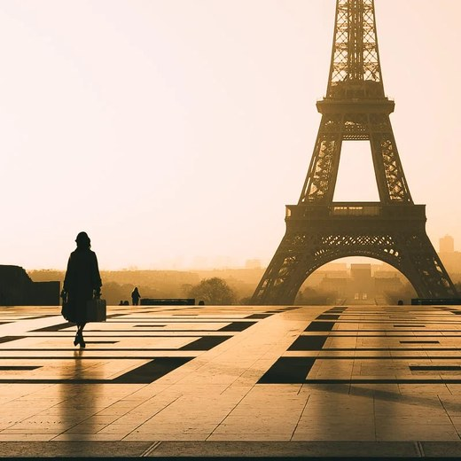
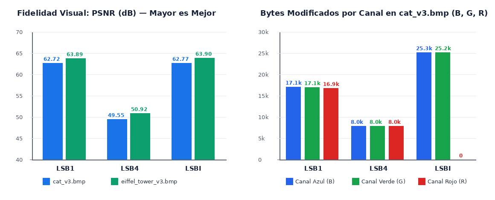
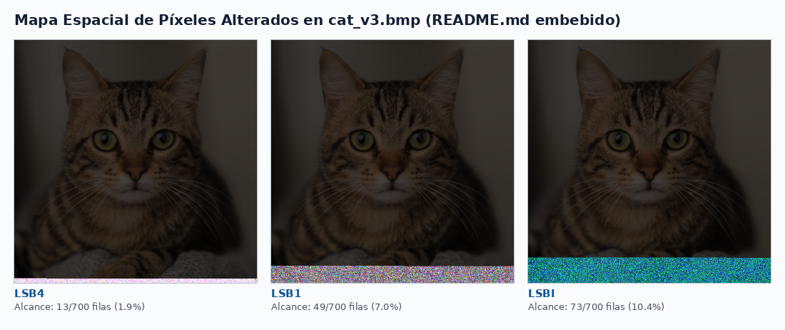
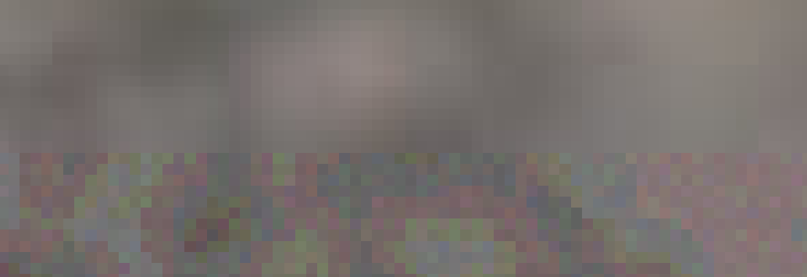
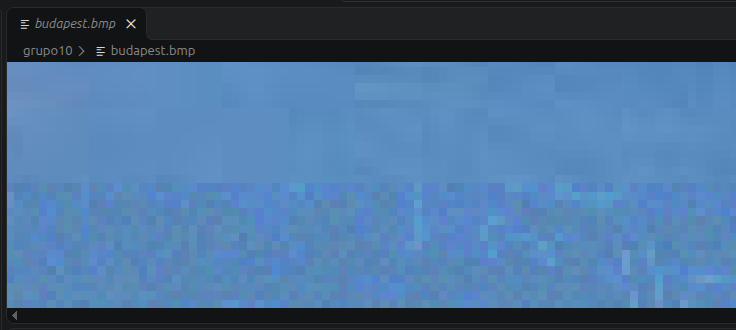
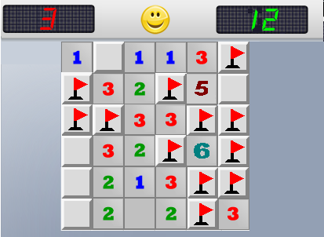
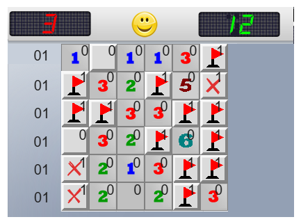
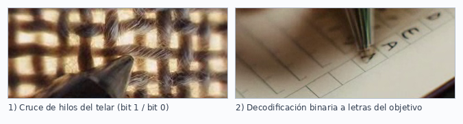

<div align="center">

<br>


<br><br>

<h1 style="color: #0b5394; border-bottom: none; margin-bottom: 4px;">72.44 - Criptografía y Seguridad</h1>

<h2 style="border-bottom: none; margin-top: 4px; color: #222222;">Trabajo Práctico de Implementación:<br>Esteganografía (<code>stegobmp</code>)</h2>

<br>

<h3>Grupo 10</h3>

| Legajo | Apellido | Nombre |
| :---: | :--- | :--- |
| 61105 | Causse | Juan Ignacio |
| 64679 | Lanari | Augusto Andrés |
| 64332 | Liu | Javier Emmanuel |
| 64292 | Rivas | Nicolás |

<br>

<table style="border: none; border-collapse: collapse;">
  <tr>
    <td style="border: none; padding: 4px 12px;"><strong>Fecha de entrega:</strong></td>
    <td style="border: none; padding: 4px 12px;">16 de Noviembre de 2026</td>
  </tr>
  <tr>
    <td style="border: none; padding: 4px 12px;"><strong>Repositorio:</strong></td>
    <td style="border: none; padding: 4px 12px;"><a href="https://github.com/jcausse-itba/CRIPTO">https://github.com/jcausse-itba/CRIPTO</a></td>
  </tr>
  <tr>
    <td style="border: none; padding: 4px 12px;"><strong>Branch:</strong></td>
    <td style="border: none; padding: 4px 12px;"><code>main</code></td>
  </tr>
  <tr>
    <td style="border: none; padding: 4px 12px;"><strong>Commit Hash:</strong></td>
    <td style="border: none; padding: 4px 12px;"><code>39cdd24ec5daaf2385633f67e07e633643abc1f6</code></td>
  </tr>
</table>

</div>

<div style="page-break-after: always;"></div>

## Índice

1. [Discusión sobre la Publicación Científica (Majeed & Sulaiman)](#1-discusión-sobre-la-publicación-científica-majeed--sulaiman) *(Apartado I)*
   - [1.1. Organización Formal del Documento](#11-organización-formal-del-documento) *(I.a)*
   - [1.2. Descripción del Algoritmo](#12-descripción-del-algoritmo) *(I.b)*
   - [1.3. Claridad de Notación, Errores y Contradicciones](#13-claridad-de-notación-errores-y-contradicciones) *(I.c)*
2. [Análisis Comparativo de Algoritmos (`LSB1`, `LSB4` y `LSBI`)](#2-análisis-comparativo-de-algoritmos-lsb1-lsb4-y-lsbi) *(Apartado II)*
   - [2.1. Ocultamiento de Prueba y Comparación de Resultados](#21-ocultamiento-de-prueba-y-comparación-de-resultados)
   - [2.2. Cuadro Comparativo de Ventajas y Desventajas](#22-cuadro-comparativo-de-ventajas-y-desventajas)
3. [Estegoanálisis de los Archivos Provistos](#3-estegoanálisis-de-los-archivos-provistos) *(Sección 6 y Apartados III–VI)*
   - [3.1. Metodología y Procedimiento de Descubrimiento](#31-metodología-y-procedimiento-de-descubrimiento) *(III)*
   - [3.2. Resultados por Archivo Portador](#32-resultados-por-archivo-portador) *(III)*
   - [3.3. Análisis de Mensajes Anidados](#33-análisis-de-mensajes-anidados) *(IV)*
   - [3.4. Análisis de la Escena de Video / Película](#34-análisis-de-la-escena-de-video--película) *(V)*
   - [3.5. Algoritmo No Estándar Encontrado](#35-algoritmo-no-estándar-encontrado) *(VI)*
4. [Discusión Técnica y Mejoras del Algoritmo](#4-discusión-técnica-y-mejoras-del-algoritmo) *(Apartados VII–X)*
   - [4.1. Fundamentación de la Mejora de LSBI frente a LSB Convencional](#41-fundamentación-de-la-mejora-de-lsbi-frente-a-lsb-convencional) *(VII)*
   - [4.2. Alternativas para el Registro de Patrones Invertidos](#42-alternativas-para-el-registro-de-patrones-invertidos) *(VIII)*
   - [4.3. Dificultades Encontradas durante la Implementación](#43-dificultades-encontradas-durante-la-implementación) *(IX)*
   - [4.4. Propuestas de Mejoras y Extensiones Futuras](#44-propuestas-de-mejoras-y-extensiones-futuras) *(X)*

<div style="page-break-after: always;"></div>

## 1. Discusión sobre la Publicación Científica (Majeed & Sulaiman)

*Análisis crítico del artículo "An Improved LSB Image Steganography Technique using bit-inverse in 24 bit colour image" (Majeed & Sulaiman, 2015, Journal of Theoretical and Applied Information Technology, Vol. 80, No. 2, pp. 342–348) — Apartado I.*

### 1.1. Organización Formal del Documento

*(Apartado I.a)*

El artículo presenta la estructura habitual de una publicación científica: un resumen inicial (*Abstract* y *Keywords*), ocho secciones numeradas y la bibliografía final. No obstante, al evaluar su organización formal se detectan desbalances estructurales y falencias editoriales relevantes:

1. **Redundancia y desproporción en las secciones introductorias:**
   Las primeras cuatro secciones (*1. Introduction*, *2. The Standard Least-Significant-Bit Technique*, *3. 24 Bit Color Image* y *4. Least Significant Bit*) consumen casi tres de las siete páginas del _paper_. En lugar de resumir los preliminares de manera concisa, los autores reiteran nociones básicas, como la diferencia entre esteganografía y criptografía, la composición RGB de 24 bits y la sustitución LSB estándar, en múltiples apartados consecutivos, postergando el aporte principal del _paper_.
2. **Falta la organización del _paper_ al cierre de la Introducción:**
   Al final de la Sección 1 (p. 343), el texto dice *"This paper is organized as follows:"*, pero falta el detalle o listado de secciones y pasa directamente a la Sección 2.
3. **Separación artificial entre descripción y pseudocódigo (Secciones 5 y 6):**
   El método propuesto se divide en *5. The Proposed Bit Inversion Technique* (pp. 344–345, enumeración de pasos y ejemplo numérico) y *6. The Proposed Bit Inversion Algorithm* (pp. 345–346, pseudocódigo). Ambas secciones describen el mismo algoritmo de inserción y resultarían mucho más claras unificadas en una sola sección metodológica que incluya, además, **el algoritmo formal de extracción (*de-steganography*)**, el cual carece de pseudocódigo y apenas se describe en prosa al final de la Sección 5.
4. **Sección experimental y conclusiones (Secciones 7 y 8):**
   La Sección 7 (*Simulation Result*, pp. 346–347) expone imágenes de prueba, histogramas comparativos (Figs. 3–5) y tablas de PSNR frente a tres trabajos previos de la literatura, pero carece de pruebas estadísticas de estegoanálisis que validen cuantitativamente la resistencia frente a detección. Además, la Sección 8 (*Discussion and Conclusion*, pp. 347–348) reproduce prácticamente las mismas afirmaciones del *Abstract* sin mayor agregado de valor.
5. **Errores editoriales, tipográficos y bibliográficos:**
   El _paper_ exhibe algunas fallas de revisión:
   - El título de la bibliografía está mal escrito como **`REFRENCES`** (p. 348).
   - Errores gramaticales y de tipeo recurrentes en inglés (*"less numbers of pixels"*, *"a steg-image"*, *"In In steganography"*, *"the lest significant bit"*, *"this this proposed method"*).
   - Inconsistencias en los nombres de los archivos de prueba entre el texto, las figuras y las tablas (`Baboon.jpg` vs. `Babbon.jpg`, `Peppers.jpg` vs. `Pepper.jpg`, `trees.jpg` vs. `tree . jpg`, `Tiffany.jpg` vs. `tifanny. Jpg`).
   - Referencias bibliográficas incompletas o con formato heterogéneo en la lista final del artículo (por ejemplo, la referencia 7 carece de año y sede de publicación, y las referencias 11 y 12 presentan formato irregular en títulos y fuentes).
   
   Esto, sumado a que (en lo personal, a los integrantes del Grupo 10) nos resultó "rara" o "difícil" la redacción en varios apartados, nos hace notar que este _paper_ careció de revisión editorial apropiada fuera de lo que refiere a cuestiones puramente técnicas.

### 1.2. Descripción del Algoritmo

*(Apartado I.b)*

La propuesta de Majeed y Sulaiman combina dos ideas sobre imágenes de colores de 24 bits con el objetivo de elevar la relación señal-ruido pico (PSNR) y complejizar la recuperación no autorizada respecto del LSB clásico:

1. **Uso selectivo de canales (Verde y Azul):** Apoyándose en la investigación fisiológica de Hecht citada en el artículo, según la cual cerca del 65% de los conos del ojo humano son sensibles al rojo, el 33% al verde y aproximadamente el 2% al azul, los autores restringen el embebido únicamente a los canales **Verde (G)** y **Azul (B)**, dejando el canal **Rojo (R)** sin alterar para que actúe como ruido o distractor ante un atacante.
2. **Inversión condicional de bits por patrones:** Luego de realizar una sustitución LSB estándar sobre los bytes útiles (G y B), cada byte portador se clasifica en uno de 4 patrones (`00`, `01`, `10`, `11`) definidos por su **2° y 3° bit menos significativo**. Para cada patrón se contabiliza cuántos bytes modificaron su LSB respecto de la imagen original (*changed*) y cuántos permanecieron iguales (*unchanged*). Si `changed > unchanged`, se invierte el LSB de todos los bytes de ese patrón (asegurando que menos del 50% de los bytes del grupo queden modificados) y se registra el estado de inversión de los patrones.

Aunque la intuición del método se comprende mediante el ejemplo de la Sección 5, **la descripción teórica y los diagramas/pseudocódigos resultan insuficientes para implementar el algoritmo sin recurrir a definiciones externas**, debido a las siguientes omisiones:

- **Ubicación indefinida del mapa de inversión (4 bits):** Tanto en el paso 6 de la Sección 5 (*"Store the status of the patterns that inverse its pixel in specific location"*) como en la Sección 6 (*"Store the status of pattern that inversed his pixels as a map in specific location"*), los autores dejan completamente sin especificar **en qué bytes de la imagen**, en qué orden ni con qué método se almacena el mapa de los 4 patrones. Sin una convención acordada, resulta imposible que un emisor y un receptor independientes interoperen.
- **Omisión del algoritmo de extracción y detalles de codificación:** La Sección 6 no presenta pseudocódigo de extracción ni define el orden de los bits dentro de cada byte secreto (MSB a LSB o viceversa) ni la forma de determinar la longitud del mensaje oculto. En nuestro trabajo práctico, esto se resolvió siguiendo el formato del enunciado (`[tamaño || datos || extensión\0]`) y grabando los 4 bits de control (`00`, `01`, `10`, `11`) mediante `LSB1` estándar en los primeros 4 bytes consecutivos del cuerpo BMP (`B0, G0, R0, B1`, sin saltear el rojo), comenzando la carga del payload recién a partir del 5° byte (`G1`) sobre canales `B` y `G`.
- **Pseudocódigo confuso e ineficiente en la Sección 6:** El primer bucle itera por carácter (`For i = 1 to n`), luego `For each 2 bits` y posteriormente `For each colour from green and blue`, mezclando granularidades (un carácter tiene 8 bits, no 2). A continuación, el segundo bloque vuelve a ejecutar `For i = 1 to n` alrededor de la comparación global de patrones, lo cual es conceptualmente erróneo porque el conteo e inversión se evalúan sobre el total de bytes utilizados y no carácter por carácter. Como se documentó en las [notas de implementación de LSBI](https://github.com/jcausse-itba/CRIPTO/blob/main/doc/LSBI_Implementation_Notes.md), una implementación correcta requiere **dos pasadas** de embebido (pudiendo omitirse la segunda si ningún patrón requiere inversión) y **una única pasada** de extracción, leyendo primero el mapa de 4 bits en un arreglo `uint8_t[4]` para aplicar XOR bit a bit sin ramificaciones.
- **Ausencia de consideraciones sobre el formato BMP y el manejo de *row padding*:** El paper describe el algoritmo sobre una secuencia abstracta de píxeles RGB sin contemplar las particularidades físicas de ningún formato de imagen (y por supuesto tampoco del formato BMP). En el formato BMP V3 de 24 bpp, los canales se almacenan en orden **`BGR`** (de abajo hacia arriba) y las filas se alinean a múltiplos de 4 bytes mediante bytes de *padding* cuando `(width * 3) % 4 != 0`. Si LSBI consumiera los bytes de *padding* dentro del flujo continuo (como sí establecen las pautas del enunciado para `LSB1` y `LSB4`), **el *padding* desalinearía el patrón periódico de salteo por canal (`B, G, R`) en cada salto de fila**. Por este motivo, tal como se registró en las [notas de implementación de LSBI](https://github.com/jcausse-itba/CRIPTO/blob/main/doc/LSBI_Implementation_Notes.md), **luego de conversarlo y acordarlo con la cátedra se tomó la decisión de diseño de no procesar ni considerar imágenes portadoras con *padding* en LSBI**, asumiendo portadoras que cumplen `(width * 3) % 4 == 0` para preservar de manera matemáticamente regular el descarte del canal rojo (`offset % 3 == 2`). Como salvaguarda adicional, `stegobmp` detecta si una portadora posee *padding* y, de poseerlo, emite un mensaje de nivel `WARN` en el *logger* al ejecutar `LSBI`.

### 1.3. Claridad de Notación, Errores y Contradicciones

*(Apartado I.c)*

La notación matemática, los pseudocódigos y los ejemplos numéricos del artículo presentan serias imprecisiones, errores tipográficos y contradicciones directas:

1. **Error tipográfico al enumerar los patrones (Sección 5, p. 344):**
   En el paso 1 de la Sección 5 se escribe literalmente **`00, 10, 10, or 11`**, repitiendo el patrón `10` y omitiendo el patrón `01` (aunque en la página siguiente, tanto en el ejemplo como en el pseudocódigo, se enumeran correctamente como `00, 01, 10, or 11`).
2. **Pérdida de superíndices en la fórmula de colores de 24 bits (Sección 3, p. 343):**
   Al calcular el total de colores posibles en una imagen RGB de 24 bits, el texto imprime **`(28)3 = 16,777,216`** en lugar de $(2^8)^3 = 2^{24} = 16.777.216$, al perderse el formato de superíndices en la edición.
3. **Inconsistencias graves en el ejemplo paso a paso de la Sección 5 (p. 345):**
   - **Byte truncado:** El cuarto byte del cover (*D*) se introduce en el paso 1 como `10101101` (8 bits), pero en el recuadro del paso 2 figura truncado a 7 bits como **`1010110`**, reapareciendo con 8 bits en `LSB stego-image` (`10101101`).
   - **Etiquetado incoherente:** En el resultado final del paso 4.c se listan tres bytes (`10001100  10101101  10101100`), pero debajo se colocan **cuatro etiquetas** (**`A   A   B   D`**), duplicando la letra `A`.
   - **Contradicción matemática en el patrón `01` (paso 4.b):** Para el patrón `01` (byte `C = 10101011`, un único byte), el texto afirma que *"no se puede verificar cuántos píxeles cambiaron y cuántos no, porque hay un solo píxel y la comparación no puede ocurrir"*. Esto es falso: con un solo elemento, si su LSB cambió (`changed = 1`, `unchanged = 0`), entonces `1 > 0` es verdadero (correspondería invertir); y si no cambió (`changed = 0`, `unchanged = 1`), `0 > 1` es falso (no se invierte). No existe ninguna indeterminación matemática para $N = 1$ (basta comparar `changed > unchanged`).
   - **Falta de información con el filtrado de canales:** El ejemplo oculta los 4 bits `1011` en los 4 bytes consecutivos `A, B, C, D` sin aclarar a qué canales pertenecen ni aplicar la omisión del canal rojo.
4. **Errores de notación en las ecuaciones de MSE y PSNR (Sección 7, p. 347):**
   - El texto define la imagen cover $C$ de tamaño $M \times M$ (píxeles $0$ a $M - 1$) y la estego-imagen $S$ de tamaño $N \times N$ (píxeles $0$ a $N - 1$), lo cual carece de sentido para una comparación píxel a píxel porque ambas deben tener iguales dimensiones.
   - Al trabajar con imágenes color RGB de 24 bits (3 canales por píxel), omite aclarar si el MSE se promedia también entre los 3 canales ($\frac{1}{3MN}$) y tampoco explicita el valor $\mathrm{MAX} = 255$ en $\mathrm{PSNR} = 10 \log_{10}\left(\frac{\mathrm{MAX}^2}{\mathrm{MSE}}\right)$.
5. **Contradicción en la longitud del mensaje secreto experimental (Sección 7, p. 346):**
   El artículo asegura que la cita de prueba utilizada *"includes 226 characters or 2881 bits"*. La cadena citada tiene efectivamente 226 caracteres ASCII, lo que equivale a **$226 \times 8 = 1808$ bits** (o 1582 bits en 7 bits), jamás `2881` bits. Por otro lado, mientras el *Abstract* (p. 342) habla de ocultar *"the first and the second most significant bits (MSB) of the secret image"*, el experimento oculta texto plano y no una imagen secreta.
6. **Contradicciones sobre capacidad y formato de las portadoras (Secciones 2 y 7):**
   - En la Sección 2 (p. 343) se menciona *"taking into consideration to increase the capacity of storing the secret data"*, cuando en realidad la técnica **disminuye** la capacidad frente al LSB estándar (pasa de 3 bits por píxel a 2 bits por píxel al descartar el canal rojo, descontando además los 4 bits reservados para el mapa).
   - Todas las imágenes de prueba en la Sección 7 aparecen referenciadas como archivos **`.jpg`** (`Lena.jpg`, `Baboon.jpg`, `Peppers.jpg`, `trees.jpg`, `Plane.jpg`, `Tiffany.jpg`). El formato JPEG aplica compresión con pérdida en el dominio de frecuencias (DCT y cuantización), lo que destruiría los bits embebidos mediante LSB espacial si la _stego-image_ se almacenara comprimida en JPEG. Debido a esto, **las técnicas LSB requieren formatos sin pérdida (_lossless_, como BMP o PNG)**.
   - Los histogramas (Figs. 3, 4 y 5, pp. 346–347) presentan un eje horizontal que llega hasta `300` (pese a que el rango de un canal de 8 bits es `0..255`) y carecen de etiquetas de ejes o especificación de canal.
7. **Errores sintácticos y semánticos en los pseudocódigos (Secciones 4 y 6):**
   - En el pseudocódigo de LSB estándar (Sección 4, p. 344): el primer bucle declara `For i = 1 to Length(c), do` pero asigna $S_j \leftarrow C_j$ (usando el índice $j$ sin inicializar); el segundo escribe la expresión inválida $S_{ji} \leftarrow \mathrm{LSB}(C_{ji}) = m_i$ mezclando asignación con igualdad; y el algoritmo de extracción recibe erróneamente `Input -: Secret image s` en vez de la estego-imagen $S$, leyendo $m_{ji} \leftarrow \mathrm{LSB}(C_{ji})$ desde el cover $C$ en lugar de $S$.
   - En el pseudocódigo de LSBI (Sección 6, pp. 345–346): utiliza asignaciones ambiguas (`Cover value = value`, `stego value = value`) y expresa la condición de inversión como *"If number of changed pixels in any pattern of pic was more than pixels that not changed in alternative pattern in the stego"*, cuando la comparación debe efectuarse respecto de los píxeles no cambiados del **mismo patrón** (`changed[p] > unchanged[p]`), no de un *"patrón alternativo"*.

A modo de conclusión, la gran redundancia presente en las explicaciones de este _paper_ hace que el lector finalmente logre comprender la solución propuesta y luego implementarla (como fue el caso del presente Trabajo Práctico de Implementación); mas la baja calidad de redacción y la alta cantidad de imprecisiones, errores, ambigüedades y contradicciones presentes sin duda dificultan su lectura y generan confusión en el lector al leerlo por primera vez.

<div style="page-break-after: always;"></div>

## 2. Análisis Comparativo de Algoritmos (`LSB1`, `LSB4` y `LSBI`)

*Evaluación experimental y comparación técnica de los métodos implementados — Apartado II.*

### 2.1. Ocultamiento de Prueba y Comparación de Resultados

Para evaluar experimentalmente los tres algoritmos implementados, se ocultó un mismo archivo de prueba —el documento [`README.md`](https://github.com/jcausse-itba/CRIPTO/blob/main/README.md) del repositorio, de **`12.735` bytes** (`12.743` bytes totales en flujo esteganográfico considerando los `4` bytes del tamaño en *Big-Endian* y los `4` bytes de la extensión `.md\0`, equivalentes a `101.944` bits)— dentro de dos portadoras BMP V3 de 24 bpp sin compresión y sin *row padding*:

<div align="center">
  <table style="border: none; border-collapse: collapse; margin: 0 auto;">
    <tr>
      <td align="center" style="border: none; padding: 8px 20px;">
        
        <br>
        <code>images/cat_v3.bmp</code><br>
        <sub>700 × 700 px · 24 bpp · 1.470.054 B</sub>
      </td>
      <td align="center" style="border: none; padding: 8px 20px;">
        
        <br>
        <code>images/eiffel_tower_v3.bmp</code><br>
        <sub>800 × 800 px · 24 bpp · 1.920.054 B</sub>
      </td>
    </tr>
  </table>
</div>

- **Comandos ejecutados:**
  ```shell
  juani@VoidX:/data/Repos/CRIPTO$ ./stegobmp -embed -in README.md -p images/cat_v3.bmp -out images/cat_README_LSB1.bmp -steg LSB1
  [  INFO  ] --> Starting embed task
  [  INFO  ] --> Saved output bitmap to "images/cat_README_LSB1.bmp"
  [  INFO  ] --> Embed task succeeded
  juani@VoidX:/data/Repos/CRIPTO$ ./stegobmp -embed -in README.md -p images/cat_v3.bmp -out images/cat_README_LSB4.bmp -steg LSB4
  [  INFO  ] --> Starting embed task
  [  INFO  ] --> Saved output bitmap to "images/cat_README_LSB4.bmp"
  [  INFO  ] --> Embed task succeeded
  juani@VoidX:/data/Repos/CRIPTO$ ./stegobmp -embed -in README.md -p images/cat_v3.bmp -out images/cat_README_LSBI.bmp -steg LSBI
  [  INFO  ] --> Starting embed task
  [  INFO  ] --> Saved output bitmap to "images/cat_README_LSBI.bmp"
  [  INFO  ] --> Embed task succeeded
  juani@VoidX:/data/Repos/CRIPTO$ ./stegobmp -embed -in README.md -p images/eiffel_tower_v3.bmp -out images/eiffel_tower_README_LSBI.bmp -steg LSBI
  [  INFO  ] --> Starting embed task
  [  INFO  ] --> Saved output bitmap to "images/eiffel_tower_README_LSBI.bmp"
  [  INFO  ] --> Embed task succeeded
  juani@VoidX:/data/Repos/CRIPTO$ ./stegobmp -embed -in README.md -p images/eiffel_tower_v3.bmp -out images/eiffel_tower_README_LSB1.bmp -steg LSB1
  [  INFO  ] --> Starting embed task
  [  INFO  ] --> Saved output bitmap to "images/eiffel_tower_README_LSB1.bmp"
  [  INFO  ] --> Embed task succeeded
  juani@VoidX:/data/Repos/CRIPTO$ ./stegobmp -embed -in README.md -p images/eiffel_tower_v3.bmp -out images/eiffel_tower_README_LSB4.bmp -steg LSB4
  [  INFO  ] --> Starting embed task
  [  INFO  ] --> Saved output bitmap to "images/eiffel_tower_README_LSB4.bmp"
  [  INFO  ] --> Embed task succeeded
  ```

- **Métricas cuantitativas obtenidas:**
  Mediante el analizador en Python implementado en `external-utilities/stego_analysis.py` (comparando byte a byte las portadoras originales frente a las 6 salidas generadas por `stegobmp`), se midieron las siguientes métricas de capacidad, alteración por canal, error cuadrático medio (**MSE**) y relación señal-ruido pico (**PSNR**):

| Portadora | Algoritmo | Cap. Máxima | Bytes Modificados (%) | Bits Mod. | Canales Modificados (B / G / R) | $\Delta_{\max}$ | MSE | PSNR (dB) |
| :--- | :---: | ---: | ---: | ---: | :---: | :---: | ---: | ---: |
| `cat_v3.bmp` | **LSB1** | 183.750 B | 51.054 (3,47%) | 51.054 | 17.123 / 17.057 / 16.874 | 1 | 0,0347 | 62,72 dB |
| `cat_v3.bmp` | **LSB4** | 735.000 B | 23.910 (1,63%) | 51.106 | 7.981 / 7.969 / 7.960 | 15 | 0,7220 | 49,55 dB |
| `cat_v3.bmp` | **LSBI** | 122.499 B | 50.513 (3,44%) | 50.513 | 25.267 / 25.246 / **0** | 1 | 0,0344 | **62,77 dB** |
| `eiffel_tower_v3.bmp` | **LSB1** | 240.000 B | 50.975 (2,65%) | 50.975 | 16.866 / 17.037 / 17.072 | 1 | 0,0265 | 63,89 dB |
| `eiffel_tower_v3.bmp` | **LSB4** | 960.000 B | 23.946 (1,25%) | 51.565 | 7.848 / 8.146 / 7.952 | 15 | 0,5263 | 50,92 dB |
| `eiffel_tower_v3.bmp` | **LSBI** | 159.999 B | 50.803 (2,65%) | 50.803 | 25.228 / 25.575 / **0** | 1 | 0,0265 | **63,90 dB** |

<p align="center">
  
  <br>
  <em>Comparación de fidelidad visual (PSNR en dB) y distribución de bytes modificados por canal en <code>cat_v3.bmp</code>.</em>
</p>

<p align="center">
  
  <br>
  <em>Mapa espacial de píxeles modificados sobre <code>cat_v3.bmp</code> (atenuada): alcance en filas desde la base inferior de la imagen y canales afectados.</em>
</p>

- **Análisis e interpretación de los resultados:**
  1. **Capacidad vs. distorsión cuadrática (`LSB4` frente a `LSB1` y `LSBI`):** `LSB4` cuadruplica la capacidad respecto de `LSB1` (`735.000 B` vs. `183.750 B` en `cat_v3.bmp`) y modifica menos de la mitad de bytes (`1,63%` vs. `3,47%`) concentrándose en apenas `13` filas inferiores (`1,9%` de la altura). Sin embargo, al alterar los 4 bits menos significativos de cada componente, cada byte modificado puede desviarse hasta $\pm 15$ niveles de intensidad ($\Delta_{\max} = 15$), multiplicando el **MSE por $\sim 20$ veces** y provocando una caída severa de **$\sim 13\text{ dB}$ en el PSNR** (`49,55 dB` en `cat` y `50,92 dB` en `eiffel`). Esta alteración de mayor amplitud introduce una franja de ruido perceptible al inspeccionar con zoom la zona embebida, especialmente sobre áreas lisas o de color uniforme.
  2. **Mayor fidelidad de `LSBI` frente a `LSB1`:** Tanto `LSB1` como `LSBI` limitan la perturbación por byte a $\Delta_{\max} = 1$, logrando valores de PSNR superiores a `62 dB` totalmente imperceptibles para el ojo humano. Aun así, en ambas imágenes **`LSBI` logró modificar menos bytes totales que `LSB1`** (`50.513` vs. `51.054` en `cat_v3.bmp`; `50.803` vs. `50.975` en `eiffel_tower_v3.bmp`) gracias a la inversión condicional por patrones, obteniendo el mayor PSNR de la comparativa (`62,77 dB` y `63,90 dB`).
  3. **Huella espacial y aislamiento del canal Rojo en `LSBI`:** Al descartar el canal Rojo (1 de cada 3 bytes), `LSBI` reduce su capacidad máxima a $\sim 2/3$ de la de `LSB1` (`122.499 B` vs. `183.750 B` en `cat_v3.bmp`) y extiende el mensaje sobre una mayor altura vertical (`73` filas = `10,4%`, frente a `49` filas = `7,0%` en `LSB1`). Como contrapartida, **los cambios en el canal Rojo son exactamente `0`** —tal como evidencian el gráfico de barras y la tonalidad puramente azul-verdosa del mapa espacial—, preservando íntegramente dicho canal frente a cualquier inspección sobre su plano LSB.

### 2.2. Cuadro Comparativo de Ventajas y Desventajas

| Algoritmo | Capacidad de Carga | Alteración Visual / Histogramas | Resistencia a Estegoanálisis | Complejidad / Pasadas | Ventajas Principales | Desventajas / Limitaciones |
| :--- | :--- | :--- | :--- | :--- | :--- | :--- |
| **LSB1** | Media ($\frac{1}{8}$ del total de bytes = `3 bits/píxel`). | Muy baja ($\Delta_{\max} = 1$; PSNR $\sim 62{,}7\text{--}63{,}9\text{ dB}$ en las pruebas). | Baja: los 3 canales se alteran de forma uniforme; una lectura directa de LSB expone el tamaño y el payload secuencial. | Muy simple: **1 pasada** tanto para embeber como para extraer; acepta *row padding* contiguo. | Sencillez de implementación, buen equilibrio entre capacidad y alta imperceptibilidad visual. | Predecible para herramientas de extracción automática y vulnerable a inspección de planos LSB en cualquiera de los 3 canales. |
| **LSB4** | Muy alta ($\frac{1}{2}$ del total de bytes = `12 bits/píxel`, $4\times$ más que `LSB1`). | Media/Alta ($\Delta_{\max} = 15$; PSNR cae a $\sim 49{,}5\text{--}50{,}9\text{ dB}$). Genera artefactos visibles en zonas uniformes y alteración notoria en planos `4-LSB`. | Muy baja: deja un corte abrupto fácilmente detectable en los 4 bits menos significativos e incluso a simple vista con zoom sobre tonos lisos. | Simple: **1 pasada** (2 nibbles por byte secreto); acepta *row padding* contiguo. | Permite ocultar archivos muy grandes en portadoras relativamente pequeñas y requiere menos bytes tocados para un mismo mensaje. | Degradación notable de la imagen (MSE alto, menor PSNR) y alta detectabilidad visual y en análisis de planos de bits. |
| **LSBI** | Moderada ($\sim \frac{2}{3}$ de `LSB1`, unos `2 bits/píxel` menos `4 bits` de mapa). | Mínima ($\Delta_{\max} = 1$; mejor PSNR observado: $\sim 62{,}8\text{--}63{,}9\text{ dB}$). El canal Rojo permanece intacto, reduciendo el impacto perceptual. | Alta frente a métodos simples: el canal Rojo actúa como ruido/distractor y la inversión por patrones limita las alteraciones por grupo a $\le 50\%$, impidiendo lectura LSB directa sin conocer el mapa. | Mayor: **2 pasadas** en embebido (2ª omitible si no hay inversión) y **1 pasada** con arreglo XOR en extracción. Requiere portadoras sin *row padding*. | Máxima fidelidad (PSNR), menor cantidad de bytes modificados y doble capa de dificultad (omisión del canal Rojo + inversión condicional). | Menor capacidad máxima ($-33\%$ frente a `LSB1`), mayor huella espacial en filas utilizadas y no soporta imágenes BMP con *padding* entre filas. |

---

<div style="page-break-after: always;"></div>

## 3. Estegoanálisis de los Archivos Provistos

*Resolución del estegoanálisis sobre los 5 archivos provistos al Grupo 10 (`budapest.bmp`, `lifeofpi.bmp`, `madrid.bmp`, `silence.bmp` y `silenceG10.bmp`) — Sección 6 del Enunciado y Apartados III a VI.*

> **Nota:** Cabe aclarar que el archivo `silenceG10.bmp` fue provisto posteriormente, debido a un error de desencriptación del original, `silence.bmp`.

> **Nota:** Debido al tamaño de las imágenes provistas por la cátedra, las mismas no fueron subidas al repositorio, pero se las referencia en este informe con los mismos nombres provistos, para evitar confusión.

### 3.1. Metodología y Procedimiento de Descubrimiento

*(Apartado III)*

> **Nota:** En el presente apartado, se describe paso a paso el procedimiento mediante el cual se realizó el proceso de descubrimiento sobre los archivos provistos, para luego en el apartado [3.2.](#32-resultados-por-archivo-portador) proveer solamente los resultados de forma breve.

Primeramente, se realizó un análisis puramente visual de los archivos provistos. Como el enunciado explicitaba el uso de `LSB4` para uno de los _bitmaps_ provistos, el primero que se buscó fue este. La razón es simple: en nuestras pruebas preliminares (como en [`images/cat_README_LSB4.bmp`](https://raw.githubusercontent.com/jcausse-itba/CRIPTO/refs/heads/main/images/cat_README_LSB4.bmp)) los archivos esteganografiados mediante `LSB4` presentan gran ruido agregado sobre la imagen en la porción donde se encuentra oculto el archivo embebido.

<p align="center">
  
  <br>
  <em>Inspección visual sobre <code>images/cat_README_LSB4.bmp</code> mostrando la alteración perceptible introducida por <code>LSB4</code>.</em>
</p>

Teniendo en cuenta esta experiencia previa, resultó natural buscar patrones similares en las imágenes provistas. De esta forma, se encontró el siguiente patrón de ruido muy similar al anterior, en la imagen `budapest.bmp`:

<p align="center">
  
  <br>
  <em>Inspección visual sobre <code>budapest.bmp</code> mostrando la alteración perceptible introducida por <code>LSB4</code>.</em>
</p>

Entonces, intuyendo que se trataba del archivo esteganografiado con `LSB4`, se procedió a intentar extraer el archivo embebido utilizando `stegobmp`: 

```shell
juani@Spectre:~/CRIPTO$ ./stegobmp -v -extract -p grupo10/budapest.bmp -out out -steg LSB4
[  INFO  ] --> Configuration:
  - embed              : false (default)
  - in                 : "(null)" (default)
  - extract            : true (set)
  - picture            : "grupo10/budapest.bmp" (set)
  - out                : "out" (set)
  - steg               : "LSB4" (set)
  - cipher-algorithm   : "AES128" (default)
  - cipher-mode        : "CBC" (default)
  - pass               : "" (default)
  - verbose            : true (set)

[  INFO  ] --> Starting extract task
[  INFO  ] --> Bitmap file: "grupo10/budapest.bmp"
[  INFO  ] --> Output base file: "out"
[  INFO  ] --> Steganography algorithm: LSB4
[  INFO  ] --> Loaded bitmap (carrier bytes: 6220800, max LSB4 payload capacity: 3110400 bytes)
[  INFO  ] --> Extracted payload (total size: 43179 bytes = 4B size header + 43170B file data + 5B extension ".png\0")
[  INFO  ] --> Saved extracted file to "out.png"
[  INFO  ] --> Extract task succeeded
```

Tras el éxito en la extracción, el programa produjo `out.png` (el nombre del archivo fue asignado de manera arbitraria, pero su extensión se encontraba dentro del secreto oculto en la imagen), una imagen del famoso juego "Buscaminas".

<p align="center">
  
  <br>
  <em>Archivo <code>out.png</code> recuperado de <code>budapest.bmp</code> (captura del juego "Buscaminas").</em>
</p>

Luego, se procedió a estegoanalizar los otros archivos (`lifeofpi.bmp`, `madrid.bmp` y `silence.bmp`), sabiendo que uno de ellos debía ser el que corresponde a `LSB1`, otro a `LSBI`, y otro el que tiene el secreto oculto mediante un método de esteganografiado no estándar.

Se intentó primero con `LSBI` sin encripción:

```shell
juani@Spectre:~/CRIPTO$ ./stegobmp -extract -out out -steg LSBI -p grupo10/lifeofpi.bmp 
[  INFO  ] --> Starting extract task
[ ERROR  ] --> Invalid extracted payload size (3192996693 bytes) exceeds maximum carrier capacity for LSBI (399999 bytes)
[  INFO  ] --> Extract task failed
juani@Spectre:~/CRIPTO$ ./stegobmp -extract -out out -steg LSBI -p grupo10/silence.bmp 
[  INFO  ] --> Starting extract task
[ ERROR  ] --> Invalid extracted payload size (123536704 bytes) exceeds maximum carrier capacity for LSBI (2304999 bytes)
[  INFO  ] --> Extract task failed
juani@Spectre:~/CRIPTO$ ./stegobmp -extract -out out -steg LSBI -p grupo10/madrid.bmp 
[  INFO  ] --> Starting extract task
[  INFO  ] --> Saved extracted file to "out.pdf"
[  INFO  ] --> Extract task succeeded
```

Como se puede ver, la extracción `LSBI` falló para `lifeofpi.bmp` y para `silence.bmp`, pero fue exitosa para `madrid.bmp`. 

Los errores para los primeros dos archivos son esperables, ya que el programa primero extrae los primeros 4 bytes _big-endian_ que indican el tamaño del archivo embebido. El error que se muestra indica que al extraer esos 4 bytes e interpretarlos _big-endian_, el tamaño declarado para el archivo embebido supera la capacidad máxima de la portadora para `LSBI`. Si dichos archivos realmente tuvieran un _payload_ esteganografiado por `LSBI`, este error no debería ocurrir, por lo que se deduce que no son `LSBI`.

La imagen `madrid.bmp` pudo ser extraída correctamente con `LSBI`, dando como resultado un archivo _PDF_ con el siguiente contenido:

> al .png cambiarle la extension por .zip y descomprimir

Luego, naturalmente, se procedió a hacerle caso a las instrucciones del `PDF`, entendiendo por `.png` a la imagen del "Buscaminas" anteriormente encontrada. Como resultado, se obtuvo un archivo de texto `sol10.txt`.

```shell
# Cambiar la extensión a .zip.
juani@Spectre:~/CRIPTO$ mv out.png out.zip

# Extraer. Produce un warning pero se ignora.
juani@Spectre:~/CRIPTO$ unzip out.zip
Archive:  out.zip
warning [out.zip]:  42829 extra bytes at beginning or within zipfile
  (attempting to process anyway)
  inflating: sol10.txt               

# Mostrar el archivo extraído.
juani@Spectre:~/CRIPTO$ cat sol10.txt
cada mina es un 1.
cada fila forma una letra.
Los ascii de las letras empiezan todos en 01.
Asi encontraras el algoritmo que tiene clave de 192 bits y el modo
La password esta en otro archivo
Con algoritmo, modo y password hay un .wmv encriptado y oculto.
```

El texto del archivo `sol10.txt` indicaba que había un mensaje oculto en el tablero del "Buscaminas", un carácter _ASCII_ por fila, donde en cada fila la posición de las minas representaba un `1` y el resto de las posiciones un `0`. Como cada fila tiene 6 columnas, precediendo `01` a cada fila (como indica la pista) se obtienen 6 tiras de 8 bits, que pueden interpretarse como 6 caracteres _ASCII_ de 8 bits cada uno.

Como en la captura del "Buscaminas" se indica que quedan 3 minas por marcar, primero se procedió a terminar el juego. Se marcaron con una cruz roja las 3 posiciones restantes con minas, y luego se interpretó cada casilla del tablero. El resultado fue el siguiente:

<p align="center">
  
  <br>
  <em>Resolución del juego "Buscaminas" y traducción a bits según <code>sol10.txt</code>.</em>
</p>

En hexadecimal, los bytes formados son (por filas, de arriba hacia abajo): `[0x41, 0x65, 0x73, 0x45, 0x63, 0x62]`. Utilizando _Python_ en modo consola, es sencillo convertir estos bytes _ASCII_ en un _string_ de forma rápida, dando por resultado `'AesEcb'`.

```python
>>> "".join([chr(b) for b in [0x41, 0x65, 0x73, 0x45, 0x63, 0x62]])
'AesEcb'
```

Luego de resolver este acertijo, y considerando también la información proporcionada por `sol10.txt` se dedujo que alguno de los restantes dos archivos (`lifeofpi.bmp` o `silence.bmp`):
- Contenía un video en formato `WMV`.
- Estaba encriptado utilizando `AES-192` en modo `ECB`.
- Utilizaba esteganografiado `LSB1` (esto se supo por eliminación, ya que el enunciado advertía que había uno con cada algoritmo de esteganografiado soportado por `stegobmp`; el único que quedaba sin utilizar era `LSB1`; y era muy probable que, si el archivo estaba encriptado, utilizara un modo de esteganografiado estándar ya que debía poder extraerse con nuestro propio programa).
- La _password_ era desconocida.

Por eliminación, también se supo que el otro de estos dos archivos restantes debía ser aquel que esté esteganografiado de forma no estándar, y que debía contener la _password_ faltante para el archivo encriptado.

Se observó el tamaño de los dos archivos utilizando `du`, esperando que haya una asimetría entre ellos: uno debía ser más pesado (y el _bitmap_ más grande), ya que debía contener un video embebido.

```shell
juani@Spectre:~/CRIPTO$ du -h grupo10/lifeofpi.bmp grupo10/silence.bmp 
4.6M    grupo10/lifeofpi.bmp
27M     grupo10/silence.bmp
```

Efectivamente, `silence.bmp` era mucho más pesado. Ese archivo debía contener el video. Ahora bien, intentar extraerlo en ese momento hubiera sido una pérdida de tiempo, ya que se sabía que estaba encriptado. Era conveniente empezar por `lifeofpi.bmp`, que se sabía que tenía un método de esteganografiado no estándar.

Para intentar revelar el contenido oculto en `lifeofpi.bmp`, se buscaron cadenas de texto legibles dentro del archivo. Como era muy probable que, de estar la información oculta como texto plano, se encontrara al principio o al final, se utilizó el comando `strings` filtrando la salida con `head` y `tail`.

```shell
juani@Spectre:~/CRIPTO$ strings grupo10/lifeofpi.bmp | head -n 3
BM6>I
x{wl~zo
yl~xk{uh|vivpcxreysfxrg~xm}ynrncsqf|zo

juani@Spectre:~/CRIPTO$ strings grupo10/lifeofpi.bmp | tail -n 3
ct}ar{hy
}vywpsqknlgjhdgeZ][Y\ZVYWRUSORPKNLHKIGJH>A?=@>;><8;9586253031/20+.,*-+(+)&)'#&$!$"
la password es aplausos
```

Al filtrar con `tail`, se extrae que la _password_ es "**aplausos**".

Luego, finalmente, se puede extraer el contenido de `silence.bmp`:
- Método de esteganografiado: `LSB1`
- Algoritmo de encripción: `AES-192`
- Modo: `ECB`
- Contraseña: `aplausos`

```shell
juani@Spectre:~/CRIPTO$ ./stegobmp -v -extract -p grupo10/silence.bmp -out out -steg LSB1 -a AES192 -m ECB -pass aplausos
[  INFO  ] --> Configuration:
  - embed              : false (default)
  - in                 : "(null)" (default)
  - extract            : true (set)
  - picture            : "grupo10/silence.bmp" (set)
  - out                : "out" (set)
  - steg               : "LSB1" (set)
  - cipher-algorithm   : "AES192" (set)
  - cipher-mode        : "ECB" (set)
  - pass               : "aplausos" (set)
  - verbose            : true (set)

[  INFO  ] --> Starting extract task
[  INFO  ] --> Bitmap file: "grupo10/silence.bmp"
[  INFO  ] --> Output base file: "out"
[  INFO  ] --> Steganography algorithm: LSB1
[  INFO  ] --> Loaded bitmap (carrier bytes: 27660000, max LSB1 payload capacity: 3457500 bytes)
[ ERROR  ] --> Failed to decrypt payload using AES192-ECB (wrong password, cipher, or corrupted data)
[  INFO  ] --> Extract task failed
```

Ahora bien, con la información proporcionada, la desencriptación falló por contraseña incorrecta. Se solicitó un nuevo archivo a la cátedra para volver a intentar, y la desencriptación del segundo (`silenceG10.bmp`), utilizando los mismos parámetros, funcionó correctamente.

```shell
juani@Spectre:~/CRIPTO$ ./stegobmp -v -extract -p grupo10/silenceG10.bmp -out out -steg LSB1 -a AES192 -m ECB -pass aplausos
[  INFO  ] --> Configuration:
  - embed              : false (default)
  - in                 : "(null)" (default)
  - extract            : true (set)
  - picture            : "grupo10/silenceG10.bmp" (set)
  - out                : "out" (set)
  - steg               : "LSB1" (set)
  - cipher-algorithm   : "AES192" (set)
  - cipher-mode        : "ECB" (set)
  - pass               : "aplausos" (set)
  - verbose            : true (set)

[  INFO  ] --> Starting extract task
[  INFO  ] --> Bitmap file: "grupo10/silenceG10.bmp"
[  INFO  ] --> Output base file: "out"
[  INFO  ] --> Steganography algorithm: LSB1
[  INFO  ] --> Loaded bitmap (carrier bytes: 27660000, max LSB1 payload capacity: 3457500 bytes)
[  INFO  ] --> Extracted payload (total size: 2041773 bytes = 4B size header + 2041764B file data + 5B extension ".wmv\0")
[  INFO  ] --> Saved extracted file to "out.wmv"
[  INFO  ] --> Extract task succeeded
```

Como se ve arriba, se logró obtener el archivo `WMV` oculto. El mismo contiene un fragmento de la película "Wanted" (2008).

### 3.2. Resultados por Archivo Portador

*(Apartado III)*

A continuación se resumen los hallazgos obtenidos tras el estegoanálisis de las portadoras provistas al Grupo 10:

| Archivo Portador | Dimensiones / Tamaño | Método Detectado | Cifrado / Parámetros | Archivo / Contenido Recuperado |
| :--- | :--- | :--- | :--- | :--- |
| `budapest.bmp` | `1920 × 1080` (`6.220.854 B`) | `LSB4` | Sin cifrado | `out.png` (`43.170 B`): captura de *Buscaminas* + ZIP anexo (`sol10.txt`). |
| `madrid.bmp` | `4352 × 2900` (`37.862.454 B`) | `LSBI` | Sin cifrado | `out.pdf` (`6.407 B`): pista *"al .png cambiarle la extension por .zip y descomprimir"*. |
| `lifeofpi.bmp` | `1600 × 1000` (`4.800.077 B`) | No estándar (`23 B` anexados post-`bfSize`) | Sin cifrado | Texto plano ASCII al final del archivo: `"la password es aplausos"`. |
| `silence.bmp` | `2500 × 3688` (`27.660.054 B`) | `LSB1` *(presunto)* | `AES-192` / `ECB` / `aplausos` | Desencriptación fallida (portadora original reemplazada por la cátedra). |
| `silenceG10.bmp` | `2500 × 3688` (`27.660.054 B`) | `LSB1` | `AES-192` / `ECB` / `aplausos` | `out.wmv` (`2.041.764 B`): fragmento de video de la película *"Wanted"* (2008). |

---

### 3.3. Análisis de Mensajes Anidados

*(Apartado IV)*

Dentro del archivo `out.png` (`43.170` bytes) recuperado originalmente desde `budapest.bmp`, se identificaron **dos mensajes ocultos anidados** en distintos niveles: uno mediante manipulación de formato de archivo y otro codificado visualmente dentro del propio contenido de la imagen.

1. **Archivo ZIP concatenado al final de `out.png` (archivo políglota `PNG + ZIP`):**
   - **Archivo contenedor de origen:** `out.png` (`43.170` bytes), extraído mediante `LSB4` de `budapest.bmp`.
   - **Mensaje secundario descubierto:** El archivo `sol10.txt` (`260` bytes sin comprimir; `173` bytes comprimidos con *Deflate*), que contenía las instrucciones clave para continuar la cadena de estegoanálisis:
     ```text
     cada mina es un 1.
     cada fila forma una letra.
     Los ascii de las letras empiezan todos en 01.
     Asi encontraras el algoritmo que tiene clave de 192 bits y el modo
     La password esta en otro archivo
     Con algoritmo, modo y password hay un .wmv encriptado y oculto.
     ```
   - **Método de ocultamiento utilizado:** **Concatenación al final del archivo (*EOF appending*) aprovechando formatos compatibles (*archivo políglota*)**. Al inspeccionar la estructura binaria de `out.png`, la imagen PNG válida finaliza exactamente en su *chunk* marcador `IEND` (en el *offset* `42.829`), e inmediatamente a continuación (cabecera `PK\x03\x04` entre los bytes `42.829` y `43.170`) se anexó un archivo `.zip` completo de `341` bytes. Como los decodificadores PNG dejan de leer al alcanzar `IEND` e ignoran los bytes posteriores, mientras que los descompresores ZIP localizan el *End of Central Directory* leyendo desde el final del archivo (tolerando bytes previos como un *warning*), el archivo resulta válido simultáneamente como `.png` y como `.zip`. Su extracción se realizó simplemente renombrándolo a `.zip` y ejecutando `unzip` (guiados por la pista del `.pdf` oculto en `madrid.bmp`).

2. **Parámetros criptográficos codificados en el tablero de "Buscaminas":**
   - **Archivo contenedor de origen:** La captura visual del juego *Buscaminas* presente en `out.png`.
   - **Mensaje secundario descubierto:** La cadena **`AesEcb`**, que combinada con la aclaración de *"clave de 192 bits"* de `sol10.txt` indicaba los parámetros de cifrado **`AES-192` en modo `ECB`** del video oculto en `silenceG10.bmp`.
   - **Método de ocultamiento utilizado:** **Codificación binaria visual sobre la disposición lógica de un tablero de $6 \times 6$ casillas**, combinada con un acertijo previo de resolución obligatoria. Cada fila de $6$ celdas codifica los $6$ bits menos significativos de un carácter _ASCII_ (`mina = 1`, `otra cosa = 0`), anteponiendo el prefijo binario `01` especificado en `sol10.txt` para completar el byte. Dado que el tablero original mostraba $12$ minas marcadas y aún faltaban $3$ por descubrir (como indicaba el contador superior izquierdo), fue necesario deducir primero su ubicación unívoca (columna $6$ de la fila $2$ y columna $1$ de las filas $5$ y $6$, según se ilustró en la sección [3.1](#31-metodología-y-procedimiento-de-descubrimiento)) para reconstruir la secuencia `[0x41, 0x65, 0x73, 0x45, 0x63, 0x62]` $\rightarrow$ `'AesEcb'`.

### 3.4. Análisis de la Escena de Video / Película

*(Apartado V)*

- **Archivo portador de origen:** `silenceG10.bmp` (`2500 × 3688` px, `LSB1` + `AES-192` en modo `ECB`, contraseña `aplausos`) $\rightarrow$ `out.wmv` (`2.041.764` bytes, `320 × 240` px, duración `53,6 s`, audio en español).
- **Escena / Película identificada:** Fragmento de la película ***Wanted*** (2008, *Se busca*), en el que Sloan (Morgan Freeman) le muestra a Wesley Gibson (James McAvoy) el secreto del **Telar del Destino** (*Loom of Fate*) empleado por la organización de tejedores llamada en el doblaje en español del clip **"La Hermandad"**.
- **Información ocultada:** **Los nombres de los objetivos (víctimas)** asignados por la organización, codificados en binario mediante aparentes irregularidades en la trama textil.
- **Portador utilizado en el fragmento:** **Paños de tela / tejido textil producidos en un telar**. Para un observador común, los saltos de hilo parecen simples defectos de fabricación de una tela ordinaria, ocultando la existencia misma del mensaje.
- **Descripción de la escena y mecánica observada:**
  Sloan relata que un clan ancestral descubrió un lenguaje binario oculto en el entrecruzamiento de los hilos del telar: **cuando el hilo vertical pasa por encima de la trama representa un `1`, y cuando pasa por debajo representa un `0`** (*"Si el hilo vertical está encima, es un uno. Si está debajo, es un cero"*). Al inspeccionar la tela con una lupa y transcribir esa secuencia de bits en una grilla sobre papel, los bloques binarios se traducen a letras que revelan el nombre del objetivo. La escena ilustra de manera directa el principio fundamental de la esteganografía: camuflar bits de datos dentro de variaciones aparentemente naturales o imperfecciones de un soporte cotidiano, de modo análogo a las alteraciones de baja significancia sobre los píxeles de una imagen digital.

<p align="center">
  
  <br>
  <em>Fotogramas de <code>out.wmv</code> (<em>Wanted</em>, 2008): cruce binario de los hilos bajo la lupa y decodificación sobre papel hacia las letras del objetivo.</em>
</p>

### 3.5. Algoritmo No Estándar Encontrado

*(Apartado VI)*

- **Archivo en el que se empleó:** *Completar.*
- **Descripción del método:**
  > *Explicar técnicamente en qué consistía el método de esteganografiado alternativo (distinto de `LSB1`, `LSB4` y `LSBI`) y cómo se realizó la recuperación.*
- **Evaluación de eficacia:**
  > *Discutir si se trata de un método eficaz y por qué, evaluando su detectabilidad visual/hexadecimal, resistencia frente a análisis estadístico, capacidad de ocultamiento y robustez ante manipulaciones del archivo.*

---

<div style="page-break-after: always;"></div>

## 4. Discusión Técnica y Mejoras del Algoritmo

*Reflexión sobre el diseño de LSBI, decisiones de implementación en C y mejoras futuras para `stegobmp` — Apartados VII a X.*

### 4.1. Fundamentación de la Mejora de LSBI frente a LSB Convencional

*(Apartado VII)*

> *Explicar por qué la propuesta de Majeed y Sulaiman representa una mejora efectiva respecto de LSB común:*
> - *Garantía de modificación máxima $\le 50\%$ en cada grupo de patrón (`00`, `01`, `10`, `11`) mediante inversión condicional de bits.*
> - *Incremento directo de la relación señal-ruido pico (PSNR) y menor distorsión estadística de pares de valores (PoVs).*
> - *Uso selectivo de los canales Azul (B) y Verde (G), dejando intacto el canal Rojo (R) como capa de ruido/distracción frente a inspectores de LSB secuencial.*

### 4.2. Alternativas para el Registro de Patrones Invertidos

*(Apartado VIII)*

> *Analizar de qué otras maneras o en qué otras ubicaciones del archivo portador/metadatos podrían almacenarse los 4 bits de control correspondientes a los patrones invertidos en lugar de anteponerlos en los primeros 4 bytes del cuerpo de la imagen (por ejemplo: campos reservados de la cabecera BMP como `bfReserved1`/`bfReserved2`, al final del flujo de píxeles, en bytes de padding de fila, o en posiciones pseudoaleatorias determinadas mediante una clave/semilla), evaluando ventajas, desventajas y riesgos de cada alternativa.*

### 4.3. Dificultades Encontradas durante la Implementación

*(Apartado IX)*

> *Detallar los contratiempos técnicos y ambigüedades enfrentadas al llevar el algoritmo del paper a la implementación final en C (`stegobmp`), considerando puntos como:*
> - *Ambigüedad del paper original sobre el almacenamiento exacto del mapa de inversión de 4 bits (definido finalmente mediante los lineamientos acordados con la cátedra).*
> - *Disposición física de los bytes en BMP (`BGR` de abajo hacia arriba) y correcta sincronización del descarte del canal Rojo a partir del 5° byte.*
> - *Manejo del padding de alineación por fila en BMP V3 (desalineación del patrón `B, G, R` en LSBI y validación con advertencia `WARN`, frente a uso contiguo en `LSB1`/`LSB4`).*
> - *Conversión explícita de endianness (`Big-Endian` para cabeceras de tamaño frente a arquitectura x86_64 `Little-Endian`).*
> - *Diseño de doble pasada en inserción (con omisión de la segunda si no hay inversión) versus extracción en una única pasada mediante arreglo `uint8_t[4]` y XOR sin ramificaciones.*
> - *Compatibilidad estricta con BMP V3 de 24 bpp sin compresión y detalles de OpenSSL (`PBKDF2-HMAC-SHA256`, modos `CFB8`/`OFB128` y padding `PKCS#5/PKCS#7`).*

### 4.4. Propuestas de Mejoras y Extensiones Futuras

*(Apartado X)*

> *Proponer optimizaciones o ampliaciones futuras para `stegobmp` (por ejemplo: dispersión pseudoaleatoria de bits guiada por semilla/clave, soporte para otros formatos sin pérdida como PNG o WAV y cabeceras BMP V4/V5, módulo de estegoanálisis automático integrado en la CLI, compresión previa al cifrado para maximizar la capacidad útil, procesamiento por streaming para imágenes de gran tamaño o cálculo integrado de métricas como PSNR).*
